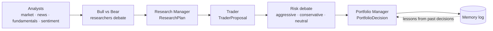
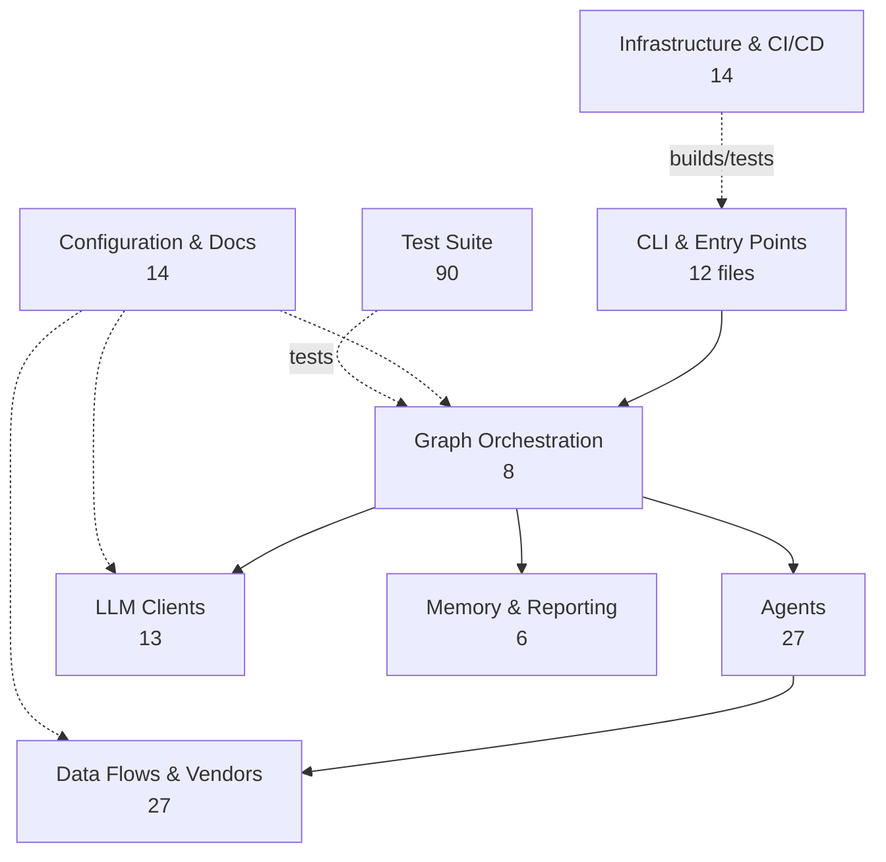

# TradingAgents — Onboarding Guide

> Made from the Understand-Anything map (`.ua/knowledge-graph.json`, commit `6522042`).
> Open the map in the dashboard: `/understand-dashboard`.

## 1. Project Overview

| Item | Value |
|---|---|
| What | A team of AI (LLM) agents that studies one stock on one date and gives a trade decision. |
| Built on | Python, LangChain, LangGraph, Typer + Rich (CLI) |
| Tools | Pytest, Docker, Docker Compose, GitHub Actions |
| Size | 202 files: 184 code, 9 config, 5 infra, 4 docs (90 test files) |
| Start here | `README.md` → `main.py` (smallest example) → `cli/main.py` (the `tradingagents` command) |

The agents work like the teams of a trading company:

## 2. Architecture Layers

| Layer | What it does | Key files |
|---|---|---|
| CLI & Entry Points | Asks the user for options, runs the graph, shows live progress. | `cli/main.py`, `cli/selections.py`, `cli/run.py`, `cli/display.py`, `main.py` |
| Graph Orchestration | Builds the LangGraph workflow and runs it (also over many dates for backtests). | `graph/trading_graph.py`, `graph/setup.py`, `graph/conditional_logic.py`, `graph/checkpointer.py`, `backtest.py` |
| Agents | One factory per agent role, plus shared state, tools and output schemas. | `agents/state.py`, `agents/schemas.py`, `agents/tools.py`, `agents/rating.py`, `agents/analysts/*` |
| Data Flows & Vendors | Gets market data from vendors. Blocks data from after the trade date. | `dataflows/router.py`, `dataflows/date_window.py`, `dataflows/vendors/*` |
| LLM Clients | One interface for many AI providers (OpenAI, Anthropic, Google, Azure, Bedrock, ChatGPT sign-in, local). | `llm_clients/factory.py`, `base_client.py`, `openai_client.py`, `capabilities.py` |
| Memory & Reporting | Saves decisions, scores them later, writes lessons. Writes Markdown/HTML reports. | `memory/log.py`, `memory/settlement.py`, `memory/reflection.py`, `report_html.py` |
| Configuration & Docs | Default settings, `TRADINGAGENTS_*` env overrides, `.env` templates, README, CHANGELOG. | `default_config.py`, `tradingagents/__init__.py`, `.env.example`, `pyproject.toml` |
| Infrastructure & CI/CD | Docker image, Compose (with optional Ollama), CI and release workflows. | `Dockerfile`, `docker-compose.yml`, `.github/workflows/*.yml` |
| Test Suite | Pytest tests for providers, vendors, no-future-data rules, checkpoints, CLI, reports. | `tests/*` |

## 3. Key Concepts

1. **No future data (look-ahead safety).** Every tool gets the run's trade date. `date_window.py` cuts all data to that date. This is the main rule of the data layer. Do not add a data path that skips it.
2. **Vendor router.** Agents never call a vendor directly. `agents/tools.py` → `dataflows/router.py` → vendor. The router falls back to the next vendor on known errors (`dataflows/errors.py`).
3. **Model tiers.** `llm_clients/factory.py` makes a separate client for each tier. Quick analysts and deep-thinking managers can use different providers.
4. **Structured output.** Managers and the trader return Pydantic objects (`agents/schemas.py`). `agents/structured.py` falls back to free text if a model cannot do structured output.
5. **5-tier rating.** One shared rating scale (`agents/rating.py`). A parser reads it from model text, and returns REVIEW when it is not sure.
6. **Debates with round limits.** `graph/conditional_logic.py` stops the bull/bear and risk debates after the configured number of rounds.
7. **Checkpoints.** Runs save to per-ticker SQLite files (`graph/checkpointer.py`), so a stopped run can continue.
8. **Memory loop.** Decision → wait for the holding window → settle the return vs. a benchmark → LLM writes a lesson → the lesson goes into later prompts.
9. **Config in one place.** `default_config.py` holds all defaults. `TRADINGAGENTS_*` env vars change them. `dataflows/config.py` keeps a separate config for each run.

## 4. Guided Tour (15 steps)

| # | Step | Read |
|---|---|---|
| 1 | Project Overview | `README.md` |
| 2 | Packaging and First Run | `pyproject.toml`, `main.py` |
| 3 | Configuration and Secrets | `default_config.py`, `tradingagents/__init__.py`, `.env.example`, `dataflows/config.py` |
| 4 | Pluggable LLM Clients | `llm_clients/factory.py`, `base_client.py`, `openai_client.py`, `capabilities.py`, `anthropic_client.py` |
| 5 | Shared State and Ratings | `agents/state.py`, `agents/schemas.py`, `agents/rating.py` |
| 6 | The TradingAgentsGraph Orchestrator | `graph/trading_graph.py`, `graph/propagation.py` |
| 7 | Wiring the LangGraph Workflow | `graph/setup.py`, `conditional_logic.py`, `analyst_execution.py`, `checkpointer.py` |
| 8 | The Analyst Team | `agents/analysts/*_analyst.py`, `agents/analysts/turn.py` |
| 9 | Tools and the Data Router | `agents/tools.py`, `dataflows/router.py`, `dataflows/errors.py` |
| 10 | Point-in-Time Data Vendors | `dataflows/date_window.py`, `vendors/yahoo/ohlcv.py`, `vendors/yahoo/snapshot.py`, `vendors/sec_edgar.py`, `dataflows/symbols.py` |
| 11 | Research Debate and Trader | `researchers/bull_researcher.py`, `bear_researcher.py`, `managers/research_manager.py`, `trader/trader.py`, `agents/structured.py` |
| 12 | Risk Debate and Final Decision | `risk_mgmt/*_debator.py`, `managers/portfolio_manager.py`, `portfolio.py` |
| 13 | Memory, Reflection and Backtesting | `memory/log.py`, `memory/settlement.py`, `memory/reflection.py`, `backtest.py` |
| 14 | The Interactive CLI | `cli/main.py`, `cli/selections.py`, `cli/run.py`, `cli/display.py`, `reporting.py` |
| 15 | Containers, CI and Releases | `Dockerfile`, `docker-compose.yml`, `.github/workflows/ci.yml`, `release-assets.yml` |

## 5. File Map

Paths without a folder prefix are under `tradingagents/`.

**CLI** (`cli/`)
- `main.py` — Typer app: `analyze` (default), `backtest`, `login`, `logout`.
- `selections.py` — gets all run options from prompts, flags or env. Checks API keys.
- `prompts.py` — interactive questions (ticker, date, analysts, depth, provider, model).
- `run.py` — runs the analysis and streams the graph to the live display.
- `display.py` — Rich live view: agent status, messages, report panels.
- `prefs.py` — remembers last answers in `~/.tradingagents/cli_prefs.json`.
- `updates.py` — daily check for new releases.
- `stats_handler.py` — counts LLM calls, tool calls, tokens.

**Graph** (`graph/`, plus `backtest.py`)
- `trading_graph.py` — the main class `TradingAgentsGraph`. Makes clients, compiles, runs, settles, reflects.
- `setup.py` — builds the StateGraph: analyst tool loops → debate → trader → risk → portfolio manager.
- `propagation.py` — initial state and run arguments.
- `conditional_logic.py` — when debates continue or stop.
- `analyst_execution.py` — order of the selected analysts.
- `checkpointer.py` — SQLite checkpoints per ticker.
- `backtest.py` — runs the graph over many tickers × dates and gives hit rates.

**Agents** (`agents/`)
- `analysts/` — market, news, fundamentals, sentiment. `turn.py` runs one tool turn + a final wrap-up.
- `researchers/`, `managers/`, `trader/`, `risk_mgmt/` — one factory per role.
- `tools.py` — LangChain tools. Each adds the trade date.
- `state.py`, `schemas.py`, `rating.py`, `structured.py`, `context.py` — shared state, schemas, rating, helpers.
- `post_screen.py` — optional social-post filter (Jev API).
- `../portfolio.py` — the user's positions, shown to decision agents.

**Data** (`dataflows/`)
- `router.py` — maps tool calls to vendors, with fallback.
- `date_window.py` — no-future-data rules.
- `config.py` — config for each run (ContextVar).
- `symbols.py` — changes user symbols to Yahoo tickers.
- `files.py`, `net.py`, `errors.py` — safe file writes, HTTP helpers, error types.
- `vendors/` — `yahoo/*`, `alpha_vantage/*`, `sec_edgar.py`, `fred.py`, `reddit.py`, `stocktwits.py`, `polymarket.py`.

**LLM** (`llm_clients/`)
- `factory.py` — makes the right client for each tier.
- `base_client.py` — common interface.
- `openai_client.py` — OpenAI-family registry (DeepSeek, MiniMax, local, ChatGPT plans).
- `anthropic_client.py`, `google_client.py`, `azure_client.py`, `bedrock_client.py` — provider wrappers.
- `capabilities.py`, `model_catalog.py`, `validators.py`, `api_key_env.py` — model features, model list, name checks, key env names.
- `chatgpt_auth.py` — "Sign in with ChatGPT" OAuth.

**Memory & Reports**
- `memory/log.py`, `settlement.py`, `reflection.py` — save → settle → write a lesson.
- `reporting.py` — Markdown report. `report_html.py` — one safe HTML page.

## 6. Complexity Hotspots

Read these slowly. Read their tests first.

| Area | Files | Why take care |
|---|---|---|
| Orchestrator | `graph/trading_graph.py` | Hub. Imports the most modules. Changes affect all runs. |
| Data safety | `dataflows/router.py`, `vendors/yahoo/ohlcv.py`, `vendors/yahoo/market.py`, `vendors/sec_edgar.py`, `vendors/fred.py`, `vendors/reddit.py` | Caching, retries, fallbacks, and no-future-data rules. A small error lets future data in. |
| Agent contract | `agents/tools.py`, `agents/schemas.py` | All analysts and managers use these. |
| LLM providers | `llm_clients/openai_client.py`, `model_catalog.py`, `chatgpt_auth.py` | Many providers, model-specific settings, OAuth and token storage. |
| CLI | `cli/run.py`, `cli/display.py`, `cli/prompts.py`, `cli/selections.py` | Large files with many branches (interactive and unattended modes). |
| Memory/backtest | `memory/log.py`, `backtest.py` | File-backed state and return calculations. |
| Output | `report_html.py` | HTML escaping and CSP. Keep the page free of scripts. |

## 7. First Day Checklist

1. `pip install -e ".[dev]"`, then copy `.env.example` to `.env` and add one provider key.
2. Run `python main.py` or `tradingagents` (the CLI).
3. Run `pytest` (integration tests are skipped by default).
4. Follow the 15-step tour in the dashboard (`/understand-dashboard` → Learn → Start Tour).
